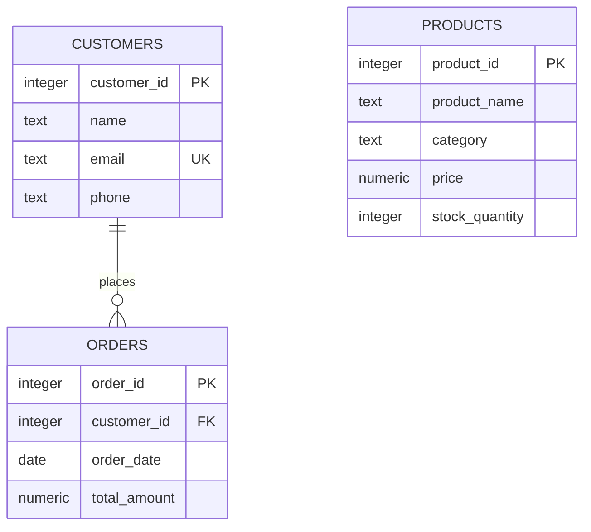

# SwiftCart Nigeria — Entity Relationship Diagram

## Current implemented database

The current PostgreSQL database contains three confirmed tables: `customers`, `orders`, and `products`.

### Entities and attributes

**CUSTOMERS**
- `customer_id` — Primary key
- `name` — Required
- `email` — Unique; nullable
- `phone` — Nullable

**ORDERS**
- `order_id` — Primary key
- `customer_id` — Foreign key referencing `customers.customer_id`
- `order_date` — Required; defaults to the current date
- `total_amount` — Required

**PRODUCTS**
- `product_id` — Primary key
- `product_name` — Required
- `category` — Nullable
- `price` — Required
- `stock_quantity` — Required; defaults to zero

## ER diagram

## Relationship explanation

One customer can place zero, one, or many orders. Each order can reference one customer through `orders.customer_id`, although the current schema permits that field to be null.

The `products` table stores product information and stock quantities. A relationship between products and orders has not yet been implemented or verified.

This diagram documents the current implementation and will be updated if the database design is extended.
